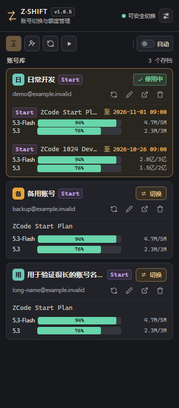

# Z·SHIFT

An independently maintained ZCode account-switching and quota companion, derived from [pjpv/zcode-switch](https://github.com/pjpv/zcode-switch) under the [MIT license](LICENSE).

The compact UI has its own name and vector mark, a single icon toolbar with hover/focus hints, and a graphite / warm-gold palette. Account avatars, primary actions, quota colors, and spacing take cues from the maintainer's AGY·SWITCH. Chinese and English are supported. Screenshots use synthetic accounts only.

This version also repairs event-claim verification, discovers explicit claim actions in both billing previews and marketing deliveries, and correlates asynchronous results with the requested account and plan.

Claimed grants scheduled for later show their amount, start time, and expiry. Spendable balances remain based on the server's balance buckets; future grants are not counted as available tokens.



## Development

Use Node.js 20.19+ / 22.12+, Rust stable, and the platform's Tauri 2 prerequisites.

```sh
npm ci
npm run tauri dev
npm run check:syntax
npm run check:i18n
npm run test:claim
npm run build
cargo test --locked --lib --manifest-path src-tauri/Cargo.toml
npm run tauri build
```

Windows is locally verified. Other platform status is reported by CI. Account data stays in `~/.zcode-switch/` for compatibility. Do not run multiple tools against the same account operation concurrently.

`npm run test:ui` checks synthetic IPC fixtures in isolated GPU-rendered browser viewports. It uses system Edge on Windows and Playwright Chromium elsewhere. It does not read account files or inject desktop input. Install Chromium with `npx playwright install chromium` when needed.

`zcode-shift.exe --claim-once --id <account-id> --plan-id <plan-id>` performs a real, explicitly targeted claim using the official passive captcha flow and returns JSON. Interactive challenges are left to the user. It does not enable the global auto-claim toggle.

See the [Chinese README](README.md) for CLI and operating details, and [NOTICE.md](NOTICE.md) for provenance. This project is not affiliated with ZCode. Upstream copyright notices and Git history are preserved.
